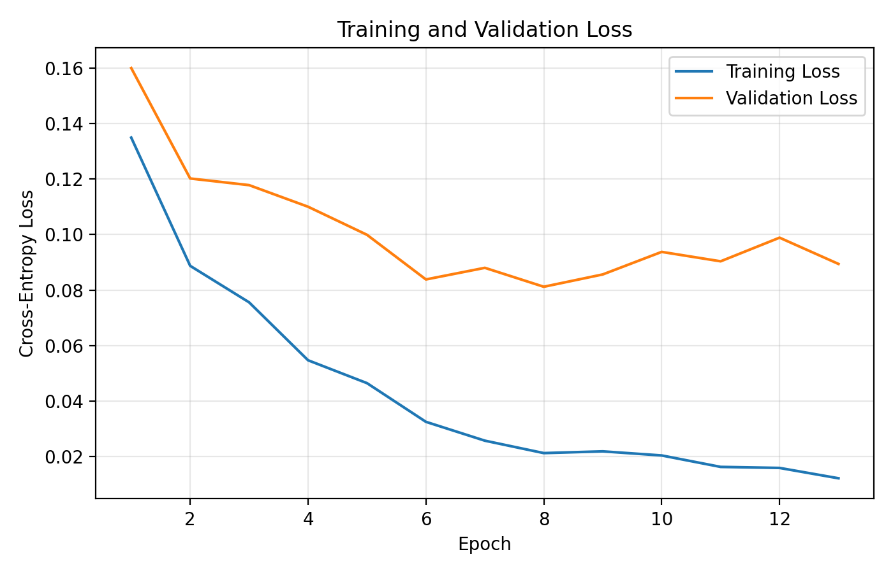

# MNIST Handwritten Digits — Neural Network from Scratch

A fully connected neural network written with **NumPy only** (no TensorFlow, PyTorch, Keras or scikit-learn model
code) that recognises handwritten digits 0–9. Forward propagation, the loss, **backpropagation** and the weight
updates are all implemented by hand, together with six extras: mini-batch gradient descent, dropout, saving and
loading weights, early stopping, the Adam optimizer and an advanced confusion-matrix analysis.

## Data

MNIST: 60,000 training and 10,000 test images of 28 × 28 grey-scale digits. Each image is flattened to a
784-dimensional vector and scaled to [0, 1]. 10 % of the training set (6,000 images) is held out as a **validation set**
(seed 42), leaving 54,000 images for training; the test set is only used for the final evaluation.

The script reads two CSV files from the current folder, `mnist_train.csv` and `mnist_test.csv` (first column = the
label, then 784 pixel columns). They are **not included** (the training file alone is about 110 MB). One way to create them:

```bash
curl -L -o mnist.npz https://storage.googleapis.com/tensorflow/tf-keras-datasets/mnist.npz
```

```python
import numpy as np, pandas as pd

d = np.load("mnist.npz")
for split, (x, y) in {"train": (d["x_train"], d["y_train"]), "test": (d["x_test"], d["y_test"])}.items():
    df = pd.DataFrame(x.reshape(len(x), -1))
    df.insert(0, "label", y)
    df.columns = ["label"] + [f"p{i}" for i in range(784)]
    df.to_csv(f"mnist_{split}.csv", index=False)
```

## What is implemented

- **`NeuralNetwork`**: any number of fully connected layers with any width and a bias on every layer except the input; He initialization for ReLU (`sqrt(1/fan_in)` for sigmoid/tanh), zero biases.
- **Activations**: ReLU, sigmoid and tanh, each with a hand-written derivative; **softmax** output.
- **Loss**: cross-entropy (with optional L2 penalty); the output gradient of softmax + cross-entropy is `(ŷ − y) / m`.
- **Backpropagation** through all layers, including the dropout masks.
- **Optimizers**: plain (mini-batch) gradient descent and **Adam** (bias-corrected first and second moments).
- **Training loop**: shuffled mini-batches, a loss/accuracy history for training and validation, and **early stopping** on the validation loss that restores the best epoch's weights.
- **Dropout** (inverted dropout, scaled by the keep probability).
- **Saving / loading** the weights (`.npz` plus a JSON file with the architecture) — reloading gives exactly the same test result.
- **Evaluation**: accuracy, loss, a confusion matrix and per-class accuracy computed by hand, plus a ranked list of the most frequent confusions.

## Final model

| Setting | Value |
|---|---|
| Architecture | 784 → 128 → 64 → 10 |
| Activation | ReLU (softmax output) |
| Optimizer | Adam, learning rate 0.001 |
| Batch size / max epochs | 64 / 30 |
| Regularization | L2 (λ = 1e-4) and dropout (keep probability 0.9 on both hidden layers) |
| Early stopping | validation loss, patience 5 |

## Results

**Test accuracy 97.89 %** (211 errors out of 10,000 images), test loss 0.068 — well above the 80 % required by the assignment.

Training stopped after epoch 13 and the weights of the best epoch (**epoch 8**) were restored. At that epoch the
training accuracy is 99.4 % and the validation accuracy 97.8 %.



- **Overfitting is visible, and early stopping handles it.** The training loss keeps falling to 0.012 while the validation loss stops improving at epoch 8 (0.081) and then drifts up. Training for all 30 epochs would only have fitted the training images more closely.

### Per-class accuracy and errors

| Digit | 0 | 1 | 2 | 3 | 4 | 5 | 6 | 7 | 8 | 9 |
|---|---|---|---|---|---|---|---|---|---|---|
| Accuracy % | 99.2 | 99.1 | 98.1 | 98.0 | 98.2 | **95.9** | 98.6 | 97.5 | 97.5 | **96.5** |

- The easiest digits are 0 and 1 (distinctive shapes); the hardest are **5** and **9**.
- The most confused pairs (errors in both directions) are **3 ↔ 5** (18), **4 ↔ 9** (15), **2 ↔ 7** (12), **2 ↔ 8** (11) and **7 ↔ 9** (10). These are digits whose strokes are easy to mix up when written carelessly: a 3 and a 5 share the same lower curve, a 4 and a 9 differ only in whether the top is closed, a 7 and a 2 share the top bar and diagonal.
- `mnist_outputs_bonus/misclassified_samples.png` shows 12 wrongly classified test images: they are mostly unusual or ambiguous handwriting, for example a 6 with an almost closed loop that is read as 0. Many of them are hard even for a person.
- The network only sees the 784 pixel values as an unordered vector, so it has no notion of shape or position; this is why small shifts or odd strokes cause errors, and a convolutional network would do better.

## Experiments

All experiments train for **5 epochs on a class-balanced random subset of 12,000 training images** (1,200 per digit, to
keep them fast) and report the accuracy on the 6,000 validation images. They use plain mini-batch gradient descent unless stated. Each setting was run **once**
(seed 42), so differences below about half a percentage point are not meaningful.

| Studied | Setting | Validation accuracy |
|---|---|---|
| Learning rate (64 ReLU units, batch 128) | 0.01 / 0.05 / 0.1 | 84.0 % / 89.3 % / 90.7 % |
| Hidden units (one layer, lr 0.1) | 32 / 64 / 128 | 90.9 % / 90.7 % / 91.0 % |
| Batch size (64 ReLU units, lr 0.1) | 64 / 128 / 256 | 91.9 % / 90.7 % / 89.3 % |
| Activation (64 units, lr 0.1) | ReLU / tanh / sigmoid | 90.7 % / 90.2 % / 85.7 % |
| Architecture (lr 0.1) | 1 hidden layer (64) / 2 hidden layers (128, 64) | 90.7 % / 92.3 % |
| Dropout (Adam, 128-64, lr 0.001) | keep 1.0 / 0.9 / 0.8 | 93.8 % / 94.4 % / 93.8 % |
| Optimizer (128-64) | mini-batch GD (lr 0.1) / Adam (lr 0.001) | 92.3 % / 93.8 % |

What the tables show:

- **Learning rate:** with only 5 epochs, a larger rate is clearly better — the small rates have simply not converged yet. Rates above 0.1 were not tried, so the effect of a rate that is too large is not shown here.
- **Width:** 32, 64 and 128 hidden units are within 0.4 points of each other; at this training budget the width is not the limiting factor.
- **Batch size:** with the same number of epochs a smaller batch is better, because it makes more weight updates per epoch (188, 94 and 47 updates per epoch for batch sizes 64, 128 and 256).
- **Activation:** ReLU ≥ tanh > sigmoid; sigmoid learns slowest because it saturates and its gradient is at most 0.25.
- **Depth:** the two-hidden-layer network is about 1.6 points better than the single-layer one.
- **Dropout:** keeping 90 % of the units is 0.6 points better than no dropout, but this is a single short run in which overfitting has not started yet, so no real benefit can be claimed from it. The final model uses dropout together with L2 and early stopping because over a longer training the overfitting above does appear.
- **Adam vs. gradient descent:** after the same 5 epochs Adam reaches higher accuracy at a much smaller learning rate, i.e. it converges faster per epoch.
- The effect of the **number of epochs** is shown by the training curve of the final model rather than by a separate experiment: more epochs help until about epoch 8 and then only widen the gap between training and validation loss.

The raw numbers are in the CSV files of `mnist_outputs_bonus/`, with a bar chart for each experiment.

## Assignment items covered

Base network from scratch (fully connected layers, three activations with derivatives, cross-entropy, backpropagation) ·
hyper-parameter analysis · error analysis · architecture comparison · bonus: mini-batch GD · dropout · save/load weights ·
early stopping · Adam · advanced confusion-matrix analysis.

## Files

| File | Purpose |
|---|---|
| `mnist_neural_network_project_bonus.py` | The whole project: network, optimizers, training, experiments, evaluation and plots |
| `mnist_outputs_bonus/final_model_*` | Training history and curves, confusion matrices (plain and normalized), test summary, and the trained weights (`final_model_weights.npz`, 0.4 MB, with a JSON description) |
| `mnist_outputs_bonus/misclassified_samples.png`, `advanced_confusion_analysis.csv` | Error analysis and the 15 most frequent confusions |
| `mnist_outputs_bonus/*_comparison*`, `hyperparameter_analysis*` | Results of the experiments (CSV and charts) |

## Run

```bash
pip install -r ../requirements.txt
python mnist_neural_network_project_bonus.py
```

Put `mnist_train.csv` and `mnist_test.csv` next to the script first. The experiments and the final training take about a
minute on an ordinary CPU. The settings (`FINAL_MODEL_CONFIG`, `RUN_*` switches, `EXPERIMENT_TRAIN_LIMIT`, …) are at the top
of the script. The seed is fixed, and a re-run with the standard MNIST data reproduces every table above and even the
saved weights exactly.
