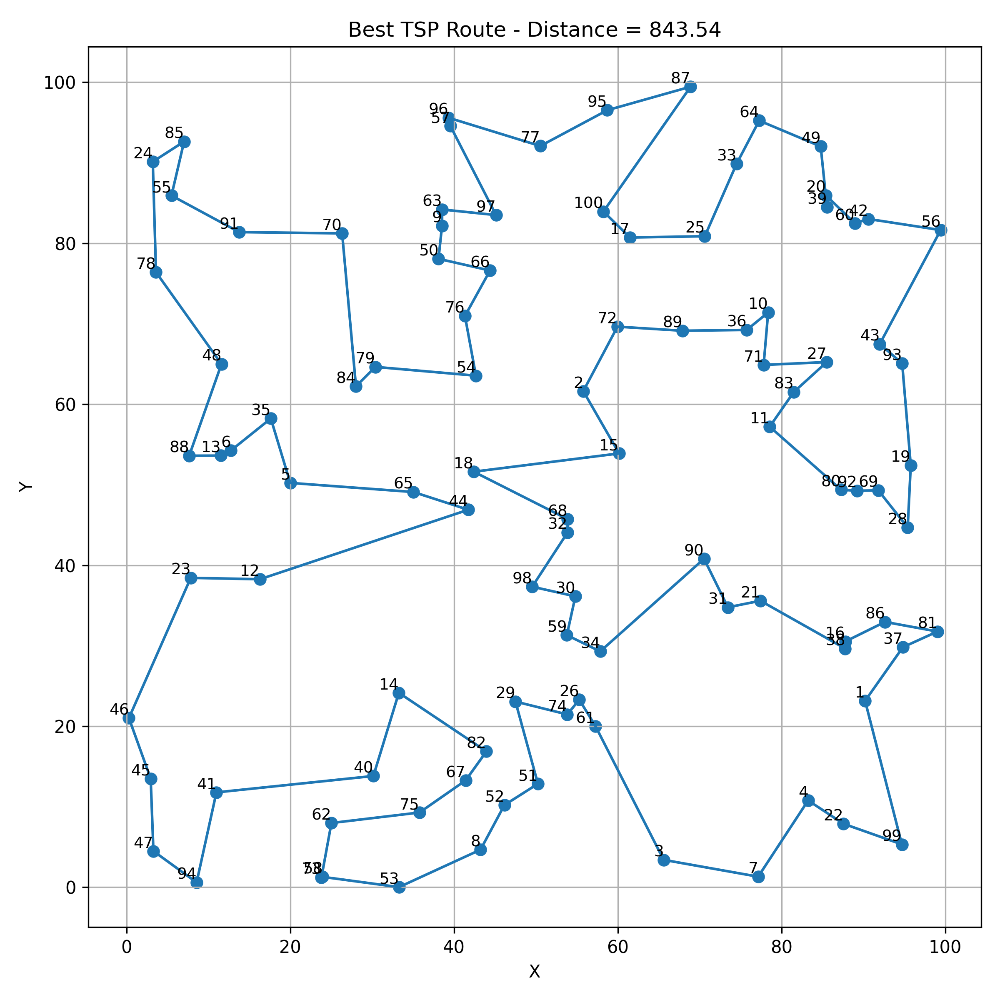

# Traveling Salesperson Problem with a Genetic Algorithm

A **genetic algorithm written from scratch** (no GA library) that looks for the shortest closed tour through a set of
cities, with convergence plots and route animations for 20, 50 and 100 cities.

## The problem and the encoding

Given `N` cities on a plane, find the shortest tour that visits every city exactly once and returns to the start. The
number of tours grows factorially with `N`, so exact search is impractical and a heuristic such as a GA is used.

- **Chromosome:** a permutation of the city indices; the order is the visiting order. A permutation can never repeat or skip a city.
- **Distances:** a Euclidean distance matrix is computed once at the start.
- **Fitness:** `1 / L`, where `L` is the tour length including the way back from the last city to the first, so shorter tours score higher.

## The algorithm (`GeneticTSP`)

| Step | What is used |
|---|---|
| Initial population | 250 random permutations |
| Selection | Tournament selection (5 random individuals compete, the fittest becomes a parent) |
| Crossover | **Order Crossover (OX)**, applied with probability 0.9 |
| Mutation | **Inversion** (reverse a random segment of the tour), applied with probability 0.25; swap mutation is also implemented |
| Elitism | The 2 best tours are copied unchanged into every new generation |
| Generations | 700 |
| Seed | 42 |

### Order Crossover on a small example

Two parents over cities 1–8 and the cut section at positions 3–5 (counting from 1):

```
parent 1 : 1 2 [3 4 5] 6 7 8
parent 2 : 3 7  5 1 6  8 2 4
```

1. Copy the section `[3 4 5]` of parent 1 straight into the child at the same positions: `_ _ 3 4 5 _ _ _`.
2. Read parent 2 starting right after the cut and wrapping around: `8 2 4 3 7 5 1 6`. Skip the cities already in the child (4, 3, 5), leaving `8 2 7 1 6`.
3. Fill the empty positions after the section in that order, wrapping around to the start: positions 6, 7, 8, 1, 2 get `8, 2, 7, 1, 6`.

Child: **`1 6 3 4 5 8 2 7`** — a valid tour (every city once) that keeps a block of parent 1 intact and the relative order of the remaining cities from parent 2. Standard one-point crossover would instead produce children with repeated cities.

## Experiments

For each size the cities are random points in a 100 × 100 square (seeded, and saved in `ga_tsp_outputs/cities_N.csv`).

| Cities | Best tour found | GA run time | Reference tour* | GA vs. reference |
|---|---|---|---|---|
| 20 | 428.16 | 6.2 s | 424.97 | +0.8 % |
| 50 | 615.64 | 17.1 s | 585.12 | +5.2 % |
| 100 | 843.54 | 44.8 s | 803.46 | +5.0 % |

\* The reference is the best of 200 randomly started **2-opt** local searches, which I ran separately as a yardstick; it is
an upper bound on the optimal length, not an exact optimum. Run times come from the saved run and depend on the machine.

| Cities | Convergence | Best route | Animation |
|---|---|---|---|
| 20 | [plot](ga_tsp_outputs/convergence_20_cities.png) | [route](ga_tsp_outputs/best_route_20_cities.png) | [GIF](ga_tsp_outputs/best_route_20_cities.gif) |
| 50 | [plot](ga_tsp_outputs/convergence_50_cities.png) | [route](ga_tsp_outputs/best_route_50_cities.png) | [GIF](ga_tsp_outputs/best_route_50_cities.gif) |
| 100 | [plot](ga_tsp_outputs/convergence_100_cities.png) | [route](ga_tsp_outputs/best_route_100_cities.png) | [GIF](ga_tsp_outputs/best_route_100_cities.gif) |



### What the results show

- **Effect of the number of cities on time.** Run time grows roughly in proportion to the number of cities (6.2 s → 17.1 s → 44.8 s for 20 → 50 → 100 cities), as expected: every generation evaluates 250 tours and each evaluation sums `N` distances.
- **Effect on quality.** The tours are valid and contain **no crossing edges**, but the larger instances are noticeably further from a good solution: about 5 % above the 2-opt reference for 50 and 100 cities, against under 1 % for 20 cities. With the same population (250) and number of generations (700), the search space grows much faster than the budget.
- **Convergence.** The best length falls steeply in the first generations and then flattens. For 100 cities the curve stops improving at around generation 570, so more generations alone would not help; a larger population, a higher mutation rate or adding a local search such as 2-opt to the offspring would be the natural improvements.
- Each size was run **once** on one random instance (seed 42), so the comparison between sizes is indicative rather than statistical.

## Files

| File | Purpose |
|---|---|
| `ga_tsp_project.ipynb` | The GA (`GAConfig`, `GeneticTSP`), helper functions and the 20/50/100-city experiments, with the code commented |
| `ga_tsp_outputs/cities_N.csv` | The city coordinates of each experiment |
| `ga_tsp_outputs/best_route_N_cities.csv` | The best tour found (city order) and its length |
| `ga_tsp_outputs/best_route_N_cities.png`, `.gif` | The best tour as a picture and as an animation that draws it step by step |
| `ga_tsp_outputs/convergence_N_cities.png` | Best length per generation |
| `ga_tsp_outputs/summary_results.csv` | Best length and run time per experiment |

## Run

```bash
pip install -r ../requirements.txt
jupyter notebook ga_tsp_project.ipynb
```

Run all cells; the results are written to `ga_tsp_outputs/` (the three GA runs take about a minute on an ordinary CPU, plus the time to draw the animations). The
seed is fixed: a re-run reproduces the same cities, the same best tours and the same lengths.
