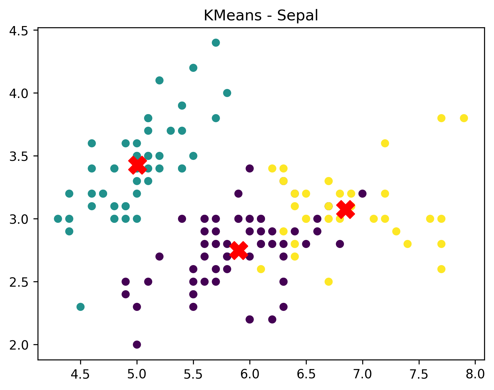
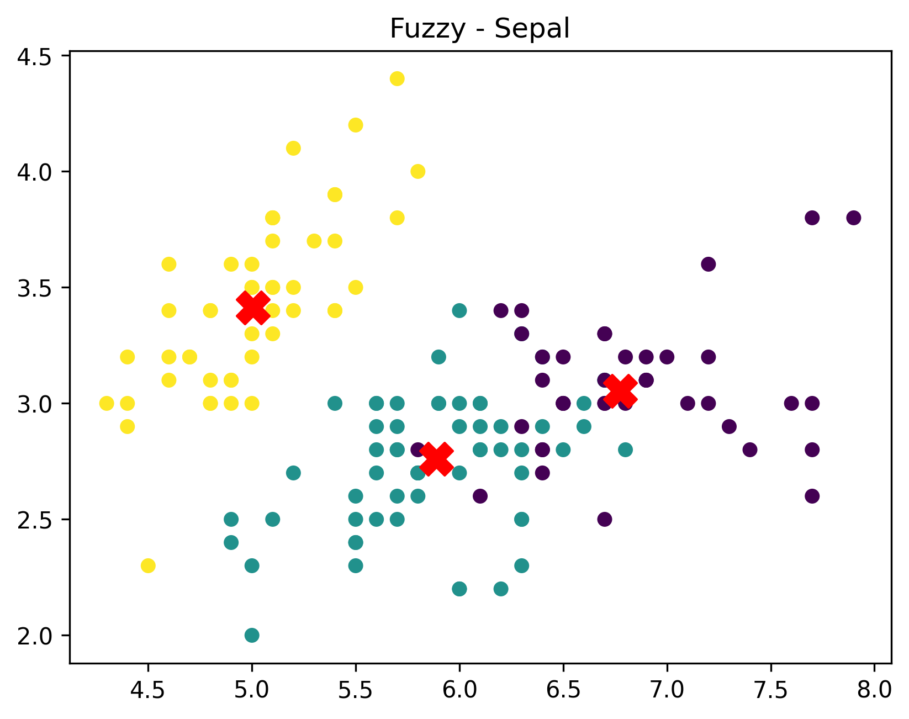
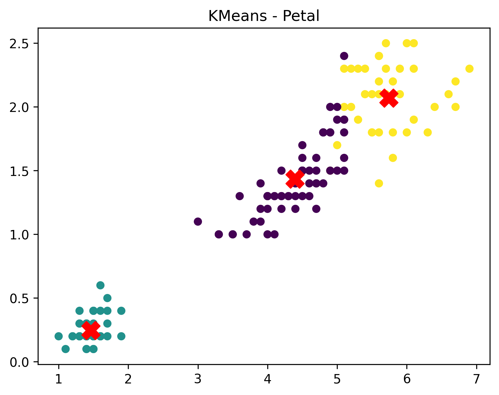
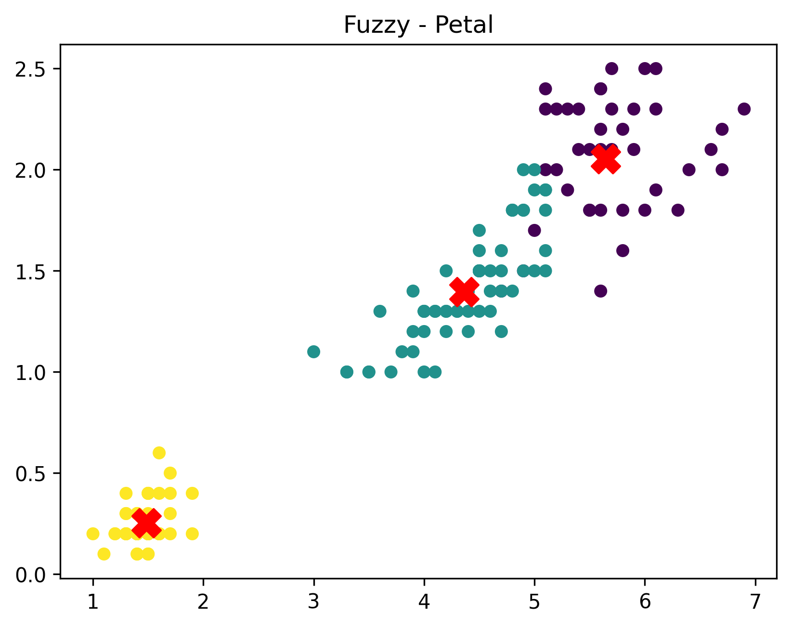

# Iris Clustering — K-Means vs. Fuzzy C-Means

K-Means (hard clustering) and **Fuzzy C-Means** (soft clustering) are both implemented from scratch with NumPy and compared
on the Iris dataset, without using the species labels.

## Data

The 150 × 4 feature matrix of Iris (sepal length and width, petal length and width), loaded with
`sklearn.datasets.load_iris` — scikit-learn is used **only to read the data**. The species labels are discarded, so
the algorithms see unlabeled points and are asked for 3 clusters.

## Implementation

**`KMeansScratch`** — random choice of 3 distinct samples as the initial centroids, Euclidean distances, repeated
assignment and centroid update until the centroids move less than `1e-4` (at most 100 iterations). One run, seed 42.

**`FuzzyCMeansScratch`** — fuzzifier `m = 2`, a random row-normalised membership matrix `U` (150 × 3) as the start, then
alternately

- centroids: `c_j = Σ_i u_ij^m · x_i / Σ_i u_ij^m`
- memberships: `u_ij = 1 / Σ_k (d_ij / d_ik)^(2/(m−1))`

until `U` changes by less than `1e-5` (at most 100 iterations). Every point gets a degree of membership in every cluster.

**Inertia.** K-Means: the sum of squared distances of every point to its own centroid. Fuzzy C-Means: the same
squared distances weighted by the memberships, `Σ_i Σ_j u_ij^m ‖x_i − c_j‖²` (the FCM objective).

## Results

| | Value |
|---|---|
| K-Means inertia | **78.85** |
| Fuzzy C-Means inertia (membership-weighted) | **60.51** |

### The two numbers are not directly comparable

The lower fuzzy value does **not** mean the fuzzy clustering is tighter. The memberships are at most 1 and are raised to
the power `m = 2`, which shrinks every term, so the fuzzy objective is on a different scale from the plain K-Means
inertia. To compare like with like, I assigned each point to its highest-membership cluster and computed the ordinary
inertia with the Fuzzy C-Means centroids:

| Clustering | Plain inertia |
|---|---|
| K-Means | 78.85 |
| Fuzzy C-Means centroids, hard assignment | 79.36 |

K-Means is slightly better on this measure, which is expected because it minimises exactly this quantity. The honest
conclusion is that the two methods find almost the same clusters; what differs is the information Fuzzy C-Means adds.

### How similar the two clusterings are

- After matching clusters, **148 of the 150 points** get the same hard label; the two points that differ both have membership 0.5 in two clusters (an exact tie).
- The cluster sizes are 62 / 50 / 38 for K-Means and 60 / 50 / 40 for Fuzzy C-Means. The 50-point cluster (the well separated *setosa*-like group) is identical; the other two overlap and share the boundary points.

### What the soft memberships add

K-Means labels every point with full confidence. The fuzzy memberships show where the data is genuinely ambiguous:

| Highest membership of a point | Points |
|---|---|
| below 0.6 | 13 (9 %) |
| below 0.7 | 22 |
| below 0.8 | 43 |
| average over all points | 0.857 |

So roughly 9 % of the flowers lie on the border between the two overlapping clusters, and a K-Means label hides this. This is the
practical advantage of soft clustering on data with overlapping groups such as Iris.

### Initialization sensitivity

The script runs K-Means once, so the result depends on the random start. Repeating the same implementation with 200 seeds
gave an inertia of 78.85 in 160 runs, but a clearly worse local optimum (142.8–145.5) in 40 runs (20 %).
The Fuzzy C-Means objective was 60.51 for all 50 seeds I tried. Restarting K-Means several times and keeping the best
run (as in the CI1 project) avoids the bad case.

## Figures

The points are coloured by the cluster (for Fuzzy C-Means, the one with the highest membership); the red crosses are the cluster centres.

| | K-Means | Fuzzy C-Means |
|---|---|---|
| Sepal length / width |  |  |
| Petal length / width |  |  |

- In the **petal** plane the three groups are clearly separated (the first cluster is far from the others) and only the two upper groups touch; in the **sepal** plane they overlap much more, so the sepal measurements alone separate the groups poorly.
- The Fuzzy C-Means plots show only the highest-membership cluster, so they look like hard clusterings; the soft information is in the membership matrix and the table above.

## Files

| File | Purpose |
|---|---|
| `kmeans_vs_fuzzy_cmeans.py` | Both algorithms, the inertia measures and the four plots |
| `kmeans_sepal.png`, `fuzzy_sepal.png`, `kmeans_petal.png`, `fuzzy_petal.png` | The cluster plots |

## Run

```bash
pip install -r ../requirements.txt
python kmeans_vs_fuzzy_cmeans.py
```

It prints the two inertia values, shows the plots and saves them next to the script. The seed is fixed (42), so the
numbers above are reproduced exactly.
